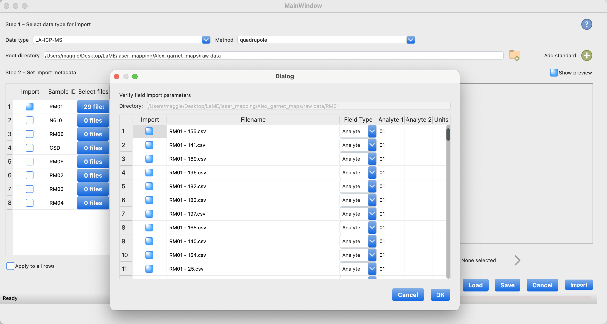

Import Formats
**************

Import formats vary by data type, and can differ based on machine manufacturer or the program used to processes the data.  This section describes the supported formats and the import process.  If you have a file type that is not included, feel free to :doc:`contact us <contact>` to see if we can write a method to suit your particular needs.

Currently, *LaME* primarily handles LA-ICP-MS data, with plans to include additional data types in future updates.

Using the Import Tool
=====================

Importing data into *LaME* is straightforward using the *Import Tool* from the *Main Toolbar* (|icon-import-directory|). Here's an overview of the process:

1. Select the data type and method (if applicable) from the dropdown menus
2. Choose the directory containing the sample files - each sample should be in its own subdirectory
3. Select the analytes for each sample (all analytes are selected by default)
4. Review your settings and click "Import" to process the data

After import, files for each sample are saved into a single file for more rapid loading, with the name format *[sample_id].lame.[ftype]*.  In most cases, the file type is \*.csv, though in some instances where color is appropriate, it may be stored as a \*.png.

    The *Import Tool* interface, shown importing LA-ICP-MS data.

Supported Data Formats
======================

LA-ICP-MS
---------

LA-ICP-MS data can be imported using different methods based on the mass spectrometer type and data format:

Quadrupole
^^^^^^^^^^

For a single sample, the data are often stored in a collection of \*.csv or \*.xlsx files.  *LaME* can read two formats, which it attempts to autodetect from the filename patterns.  While its ability to handle filename formats are limited, it will probably handle most reasonable naming schemes.  In both cases the collection of files should be stored in a directory given by the sample ID.  Once read in, the data are exported in a single file, common data format with a *.lame.csv* suffix and extension.

For data collected on quadrupole mass spectrometers, the only requirement for import is the sample ID.  The columns in the table are as follows:

:Import: checkbox indicating whether to include the directory for import.
:Sample ID: sample identifier and name of the directory which holds the files associated with the sample.
:Select files: opens the Analyte Selection dialog to choose which analytes to import for each sample.
:Standard: select the standard used to calibrate the data or standard to calibrate the data (once we implement calibration).  Note additional calibration files may be added to the standard list.  Standards analyses should follow similar file naming conventions as described below.
:Scan axis: the direction of the scan lines, either *X* or *Y*.
:Swap XY: swap the *X* and *Y* dimensions.
:X reverse: reverse the direction of the *X* data.
:Y reverse: reverse the direction of the *Y* data.
:Spot size (µm): laser spot size, used to determine distance between scan lines.
:Sweep (s): time to complete a full suite of analytes.
:Speed (µm/s): rate of travel of the laser.

For data collected on quadrupole mass spectrometers, the requirement for import is the sample ID. The distance along the scan line is given by *sweep* \* *speed*. If these parameters are not entered, then the pixels are assumed to be equidimensional (i.e., *dx* = *dy*). These parameters can be updated after uploading in the *dx* and *dy* edit fields of the *Sample and Fields* tab.

*LaME* supports two common file formats for quadrupole data:

1. Scan Line Format
^^^^^^^^^^^^^^^^^^^

Files include all recorded analytes for a single scan line in each individual file.  This file format is typically used for raw data in CPS. Filenames for this format often include a sample number and a line number separated by a delimiter.  These can come in any order and a variety of delimiters may used.  *LaME* strips away these common elements to identify the line numbers.

Example filenames include:  

- RM03-3.csv
- RM05 - 10.csv
- TR3-06-1.csv
- M252-m1 - 6.csv
- 90-75B-PY-3.csv
- 121.csv

In all but the last two cases above, the line number came last.  The order doesn't matter: *LaME* reads the directory listing as a whole and takes the line number to be the part of the filename that is a number in *every* file and different in *every* file.  A sample name's digits are numbers too, but they repeat, so they cannot be mistaken for it.  The line number, along with spot size, gives the distance between lines, which is defined as the *X*-direction.

The *Select files* dialog states which part it read as the line number, and offers the alternatives when more than one part fits.  Changing it renumbers every file in that directory at once, and the choice is reused for the remaining samples — one instrument session normally names its files the same way throughout.

.. note::
   *LaME* decides whether a directory holds scan lines or analyte matrices by **reading** the files, not by interpreting their names: a scan-line file opens with an instrument preamble and a ``Time [Sec]`` header row, while a matrix file is a bare grid of numbers.  This matters because an element symbol followed by a number is indistinguishable from a sample name followed by a line number — lines 10 and 11 of a sample called ``75B-Large CPY`` read as the boron isotopes B10 and B11 if you only have the filename to go on.  Once the layout is known from the data, no analyte is looked for in a scan-line filename at all.

   Whatever *LaME* cannot interpret is named at the top of the *Select files* dialog and counted, rather than being quietly left unticked.  If files are missing from a map, that is the first place to look.

Each file should include several metadata lines followed by a header and the table of values with results from each analyte in a separate column.  The first column is the time along the line.  The difference in times are the sweep time and should be constant from measurement to measurement.  The sweep time along with the rate of travel of the laser is used to determine the distance along the line.  This distance is the *Y*-direction.  A snippet is shown in the table below, with the first three lines removed.  These three lines do not provide metadata useful to *LaME*.

 .. csv-table:: Scan-line file from LA-ICP-MS quadrupole
    :file: _static/tables/la-icp-ms_line_snippet.csv
    :widths: 11 11 11 11 11 11 11 11 11
    :header-rows: 1

.. note::
   Scan line data may include files with standards.  These standards will sit between scan lines of the sample resulting in non-sequential line numbers for the sample, which is accounted for by *LaME* when converting to distance.

   Standards are recognised from their filenames and are unticked for you in the *Select files* dialog, where they remain listed so you can see what was identified and tick one back on if a sample line was misread.  Because the line's position in the map comes from its *order* among the files being imported rather than from the number in its filename, the gap a standard leaves does not become a gap in the map.

.. note::
   Many instruments close each scan-line file with a blank line and a trailing ``Printed:<date time>`` stamp.  *LaME* stops reading at the end of the numeric block, so this footer does not become an extra pixel.  The time column itself is used to establish the sweep interval and is then dropped, since it records the instrument's clock rather than a measurement and would otherwise be offered alongside the analytes.

.. warning::
   The two orientation fields are easy to read the wrong way round.  *X reverse* applies to the axis **across** the scan lines — the direction in which successive files advance over the sample.  *Y reverse* applies to the axis **along** each scan line — the direction the laser travelled.  If a map comes out mirrored, that is the pair to check.  Use *Swap XY* when the scan lines run horizontally rather than vertically, so that the along-line axis becomes *X*.

2. Matrix Format
^^^^^^^^^^^^^^^^

An alternative format reports each analyte in a separate file as a matrix (map-form) and may be produced after calibration and/or processing in Iolite or XMapTools, generally used to report data in PPM, though they may still be in CPS.  The filenames are generally constructed from the sample name and the analyte and often include the units and matrix, though the only important component is the analyte, which is use to define the column in the output data.  The order of the mass and symbol can be either mass first or mass last conventions.

Example filenames:

- 23Na.csv
- RM03 Dy163_ppm matrix.csv
- 4337064_grt03 Ba137_CPS matrix.csv
- B10B_SMALL_ppm K39_ppm matrix.csv

|

Each file should include a matrix of data without headers, line numbers, distances, or times.  The default reads columns as the *X* coordinate and rows as the *Y*.  A snippet is shown in the table below.

 .. csv-table:: Analyte-matrix file from LA-ICP-MS quadrupole
    :file: _static/tables/la-icp-ms_matrix_snippet.csv
    :widths: 16 17 16 17 16 17
    :header-rows: 0

Other Data Types (Coming Soon)
==============================

The following data types and formats are planned for future implementation:

- TOF (HDF5)
- MLA
- XRF (\*.png, \*.tif)
- SEM
- CL
- Petrography (\*.png, \*.jpg, \*.tif)

